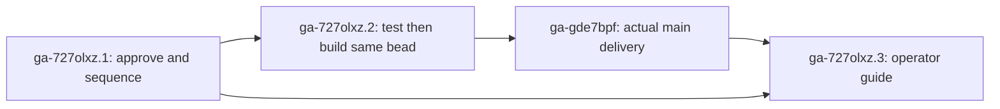

# Asleep named-session launch-drift continuity

Status: planning complete; product behavior approved with guardrails; architecture sequencing and wake proof remain gated.
Root: `ga-727olxz` (P3, architect-origin).
Source baseline: `37bd09351ac80604606366872b4efeed63b624b8`.
Public feature discussion: https://github.com/gastownhall/gascity/issues/8370.

## User outcome

An operator editing only launch configuration should not lose an asleep
configured-named session's tracked conversation merely because the session was
asleep. The next wake should use the new approved launch configuration and
resume the same conversation, just as the alive launch-only path does today.
The architect's read-only snapshot found 16 asleep configured-named sessions
among 34 sessions; that measures exposure, not prior failures. Mayor's ruling
reports a related September model-change restart that lost conversation
context; it does not establish that the reset used this asleep repair path.

The source fixes the hash predicate: both stored tier hashes are present,
provision still matches, and launch does not. The approved continuity case
additionally keeps the same provider/runtime that owns the conversation key. The asleep predicate does not
require a provider capable of relaunching a live runtime. Provision drift,
mixed provision/launch drift, and either missing tier hash retain the existing
fresh-conversation reset. Version-artifact and unrelated live-tier handling
must retain their existing meaning.

## Decisions before implementation

`ga-727olxz.1` is a real enabling prerequisite, not a courtesy note:

- Mayor APPROVED resuming old history after a Launch-tier Command/model-flag
  edit in `gm-wisp-22up1jw` (read and recorded on the decision). This applies
  only within the same provider/runtime that owns the key. A provider/runtime
  change retains today's reset. If the new launch cannot resume (rejected id,
  missing conversation, or model context limit), it must fall back safely to
  a fresh conversation without a crash loop or wedge. Architect defines how
  existing recovery is reused and the validator proves this failure outcome;
  PM does not assume the existing helper already guarantees it.
- Architect must identify the actual C7b2 migration owner/carrier and select
  sequencing. Both still-serving legacy and decide/effect paths must agree;
  arms-only work requires proof that legacy is actually retired first.
  A planned retirement or a build/review handoff is insufficient. Wire any
  discovered prerequisite as a native same-store edge before releasing work.
- Architect must trace the next-wake/start behavior for a preserved key and
  rebaselined hashes, and specify observable resume proof for session-id and
  resume-only provider shapes. A metadata key alone does not establish resume.
  Any additional defect is a prerequisite, not a claim that this feature works.

A rejected product decision returns to PM for revised acceptance or
abandonment; closing a decision with a no-go must not enable contradictory
implementation. No new primitive, hashed input, tier partition, wire/config
surface or doctor behavior is proposed.

## Work packages

| Bead | Outcome and acceptance | Route | Native prerequisite |
|---|---|---|---|
| `ga-727olxz.1` | Carry the approved same-provider/fail-safe model ruling into migration sequencing/owner and next-wake proof; return an enabling architecture contract on the same record. | `needs-architecture` → architect | None initially; architect records any actual migration prerequisite. |
| `ga-727olxz.2` | One test-first behavior scope: preserve key on proved same-provider launch-only asleep drift, rebaseline core/provision/launch, clear both drift-stamp pairs, converge next tick, and resume on the actual next start. Preserve conservative negative cases and all lifecycle safety fences. Update both serving paths and their parity evidence unless the ruling proves retirement. Own the required scenario/requirements/AGENTS change in the same behavior PR. | `needs-tests` → validator → SAME bead to builder | `ga-727olxz.1` |
| `ga-727olxz.3` | Update the existing operator configuration guide with the shipped retention boundary and one accurate approved config example; preserve the command/resume-command wrapper caveat and avoid internal sequencing details or unsupported provider promises. | `ready-to-build` → builder (docs only) | `ga-727olxz.1` and `ga-gde7bpf` |

`ga-gde7bpf` is an unrouted condition record, not a fourth delivery scope.
It depends on `ga-727olxz.2` and stays OPEN until a public PR is confirmed
merged/shipped, the exact merge/source commit is verified on current main,
and required named resume/parity evidence is recorded. Build close, reviewer
PASS, deploy handoff and PR creation are insufficient. Mayor closes this
record on actual evidence. If the ruling is no-go, PM disposes held work
rather than claiming delivery.

All graph endpoints are in the gascity store. Work packages are children of
this root and carry `discovered-from:ga-i3yh2a`, the actual origin that this
root itself traces to; the ledger cannot store parent-child and
discovered-from as two types on the same ordered pair. No foreign blocks
reference is relied on for readiness. Child notes carry full Build/acceptance
text, so builders need not reconstruct scope from this diagram.

## Binding implementation evidence

The validator and builder use **one** needs-tests bead for the behavior:

1. Show a real pre-fix RED for the positive asleep launch-only case, then
   named PASS evidence for unchanged key, updated tier/core hashes, cleared
   deferrals and second-tick convergence. The existing direct-reset helper
   test remains unchanged and passing.
2. Prove actual next-wake/start uses the original conversation and new approved
   launch config for session-id and resume-only provider shapes, without
   duplicate startup prompts or a fresh conversation. Include the approved same-provider Command/model case, a provider/runtime
   switch that resets, and failed-resume cases (rejected id, missing
   conversation, model context limit) that safely start fresh without looping
   or wedging. Provider coverage and seams follow the architect's
   ruling; no paid live-model dependency is imposed by this plan.
3. Preserve provision/mixed/missing-tier reset behavior, no-drift and
   version-artifact behavior, and correct independent handling of live updates.
   Do not mark a live update applied merely by rebaselining too much metadata.
4. Preserve unknown-liveness, pending-resume lease, concurrent-write and write
   error safety. A stale repair must not overwrite a newer conversation key.
5. Keep all still-serving reconciliation paths equivalent and change their
   owned scenario ledger/requirements and invariant documentation in the same
   PR. This is an intentional behavior change, not a behavior-preserving
   extraction that can silently weaken characterization tests.
6. Use authoritative Bazel unit/policy/format/generated gates and matching
   behavior integration/acceptance tiers under `TESTING.md`; register new test
   files with `make bazel-sync`. Filtered evidence names actual test PASSes;
   skips and zero-match results are not proof. Ordinary independent review,
   complete fresh deploy gate and MPR/operator merge rules remain in force.

PM authored no implementation or tests and claims no feature validation PASS.
The documentation package follows `.claude/skills/gascity-docs/SKILL.md` and
its documentation gates after actual behavior delivery. The required internal
scenario/AGENTS updates remain in the behavior PR, not delayed to that package.

## Delivery, risks and scope

Priority stays P3: this exact asleep-repair inconsistency is established in
source; the mayor's related historical model-reset incident is supporting
context, not a reproduced asleep-path failure. The principal risks are a model/command
semantics mismatch, assuming that a kept key is enough to resume, racing the
mid-migration path ownership, and accidentally clearing unrelated lifecycle or
live-config state. The product ruling supplies the required same-provider and fail-safe
boundaries; the remaining architecture contract and native blockers address
the engineering uncertainties before implementation.

The obsolete doctor discovery `ga-i3yh2a`, its uncommitted RED test and the
older Option A' history remain separate. No alive/pinned/attached behavior,
new diagnostic, field hashing change, runtime restart, config edit, deployment
or fleet migration is authorized by this plan. No duplicate implementation,
review or gate carrier is requested. If admission defers a handoff, retain the
original record and deferred metadata; do not retry or promote priority to
bypass the fleet budget.

Tracker import: no tracker-to-beads importer or sibling tracker skill was
installed in the local skill overlay on intake, so import is a no-op; no
tracker-sync manifest was created. The GitHub feature issue is the public
motivation/verification discussion, and beads are the downstream execution
contract.

The planning root closes only after this exact document is committed and its
path is rechecked clean. That closure records plan delivery, not feature
shipping; all implementation and actual-main conditions stay live.
